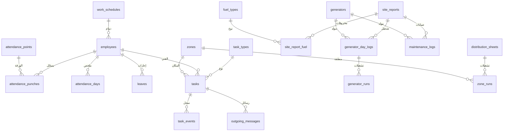

# نظام تشغيل مخيم 2 · الخطوة 0: مخطط البيانات والقواعد

> معتمدة · 30 أكتوبر 2026 · لم يُكتب أي كود بعد.
> هذا الملف هو المرجع لكل الخطوات القادمة، وسأحدّثه كلما اعتمدت شيئاً.

---

## 1. ما اعتمدته

| الموضوع | القرار |
|---|---|
| مكان النظام | في مستودعك داخل مجلد `mukhayyam-2`، ولا علاقة له إطلاقاً بنظام AF PowerCollect. آخذ من المشروع الأساسي الشعار والصور فقط. |
| المدير | رامي أبو عجوة. يرى التقارير جاهزة على حاسوبه لحظة إرسالها من الموقع. |
| الأرقام في التقارير | كل أرقام تقرير التوليد وكشف التوزيع يعبّئها الموظف في الموقع بنفسه، تماماً كالورقة. النظام لا يحسب أي حقل فيها. |
| التصميم | هوية جديدة فاخرة بمستوى أفضل أنظمة 2026، تُعرض عليك قبل بناء أي شاشة. |
| إرسال المهام | SMS أو واتساب، والمدير يختار. |
| بدون إنترنت | نعم، في كل شاشات الإدخال. |
| الأوقات | من الخادم، لا من ساعة الجوال. |
| الأحمال | أمبير أو كيلوواط، يختار من يعبّئ. |
| مدة المهمة | يحددها المدير لكل مهمة. |
| الدوام | 8:00 ص – 5:00 م، وموظفو البطالة 8:00 ص – 2:00 م. |
| الحضور | ورقة QR مطبوعة ثابتة معلّقة في المكتب. |
| الزجاج (Glassmorphism) | للرأس وبطاقات المؤشرات والنوافذ. الجداول ونماذج الإدخال بأسطح صلبة واضحة تُقرأ تحت الشمس. |

---

## 2. التقنية المقترحة

| الجزء | الاختيار | لماذا |
|---|---|---|
| التطبيق | React + TypeScript، تطبيق ويب يُثبَّت على الجوال (PWA) | يفتح فوراً، يُثبَّت من المتصفح بلا متجر تطبيقات، ويعمل بدون إنترنت. نفس التطبيق للجوال واللوحي والحاسوب. |
| الخادم وقاعدة البيانات | Supabase (PostgreSQL) | قاعدة بيانات قوية، وتسجيل دخول، وتحديث حي للوحة المدير (العدّادات وحالات المهام تتغير أمامه دون تحديث الصفحة)، ووقت الخادم في كل تسجيل. |
| الاستضافة | Cloudflare Pages أو Vercel | مجانية وسريعة. |
| التكلفة | مجانية لحجم مخيم 2 | النسخة المجانية من Supabase تتوقف إذا لم يُستخدم النظام أسبوعاً كاملاً، والاستخدام اليومي يمنع ذلك. رسائل SMS الآلية وحدها لها تكلفة (انظر الوحدة 3). |
| ما أحتاجه منك لاحقاً | حساب Supabase مجاني | عند ربط البيانات الحقيقية فقط. حتى ذلك الحين أبني وأختبر على قاعدة بيانات محلية. |

**الدخول:** رقم الجوال + رمز سري من 4 إلى 6 أرقام، ويبقى المستخدم مسجّلاً على جهازه فلا يكتبه كل مرة.

---

## 3. المستخدمون والأدوار

| الدور | ماذا يفعل | جهازه غالباً |
|---|---|---|
| مسؤول النظام (أنت) | كل الصلاحيات، إضافة المستخدمين، الإعدادات | حاسوب وجوال |
| المدير (رامي أبو عجوة) | يرى كل شيء، يعتمد التقارير، يسند المهام، يتابع الحضور | حاسوب وجوال |
| مشغّل موقع التوليد | يعبّئ تقرير التوليد اليومي | جوال |
| مشرف التوزيع | يعبّئ كشف التوزيع والأحمال | جوال |
| فني | يستلم المهام وينفّذها | جوال |
| موظف | حضور وانصراف فقط | جوال |

كل مستخدم يسجّل حضوره وانصرافه، أياً كان دوره.

---

## 4. الوحدة 1: تقرير موقع التوليد اليومي

**كيف يعمل:** المشغّل في موقع التوليد (لا في المكتب) يعبّئ التقرير على جواله خلال اليوم، ويُحفظ على جهازه أولاً بأول كمسودة. في النهاية يضغط «إرسال للمدير» بدل التوقيع على الورقة، فيظهر التقرير جاهزاً عند المدير رامي أبو عجوة على حاسوبه. المدير يفتحه بنفس ترتيب الورقة (المحروقات، ثم التشغيل والأحمال، ثم الصيانات، ثم الملاحظات)، ويتنقّل بين الأيام بالأسهم أو التقويم، ثم يضغط «اعتماد».

بعد الإرسال لا يُعدَّل التقرير إلا إذا أعاده المدير للتصحيح، وكل تعديل يُحفظ في سجل التغييرات.

### المولدات (تُعرَّف مرة واحدة)

| الحقل | ملاحظة |
|---|---|
| الاسم | مثل «المولد 1» أو «الكبير» |
| الماركة | قائمة بالماركات المنتشرة في غزة: Perkins، Cummins، Caterpillar، Volvo Penta، FG Wilson، MAN، Deutz، Mitsubishi، Doosan، SDMO، Iveco، Scania، Baudouin، Weichai، Yuchai، أو «أخرى» تكتب اسمها بنفسك |
| الموديل | اختياري |
| القدرة | بالـ kVA، وتُستخدم لحساب نسبة الحمل |
| الحالة | فعّال أو موقوف. الموقوف لا يظهر في تقرير اليوم |

### المحروقات (سطر لكل نوع وقود: سولار صناعي، سولار إسرائيلي، ويمكن إضافة نوع)

كل الحقول يعبّئها المشغّل بنفسه، كما في الورقة.

| الحقل | ملاحظة |
|---|---|
| الرصيد الموجود | لتر |
| الكمية الواردة | لتر |
| المجموع | لتر |
| الرصيد المتبقي | لتر |
| الاستهلاك | لتر |
| رقم الإرسالية | نص، ويقبل أكثر من رقم إن وصلت أكثر من شحنة |
| ملاحظات | اختياري |

### التشغيل والأحمال (سطر لكل مولد فعّال، يعبّئه المشغّل)

| الحقل | ملاحظة |
|---|---|
| التشغيلات | حتى 3 تشغيلات، لكل واحدة «من – إلى»، وتقبل ما يتجاوز منتصف الليل (مثل 8 م – 1 ص) |
| ساعات التشغيل | ساعات |
| الأحمال | 3 فازات (L1، L2، L3) بالأمبير أو الكيلوواط |
| الحرارة | °C |
| ضغط الزيت | bar أو psi |

### الصيانات (سطر لكل عملية صيانة)

| الحقل | ملاحظة |
|---|---|
| المولد | من القائمة |
| زيت جديد | لتر |
| زيت محروق | لتر |
| نوع الصيانة | قائمة: تغيير زيت، فلتر زيت، فلتر سولار، فلتر هواء، تبريد ورديتر، بطارية، سير، دينمو وكهرباء، أخرى، مع وصف حر |

### الملاحظات العامة

نص حر في آخر التقرير.

---

## 5. الوحدة 2: كشف التوزيع والأحمال

**كيف يعمل:** مشرف التوزيع يعبّئ الكشف اليومي على جواله ويرسله، وكل الأرقام يعبّئها بنفسه كما في الورقة. المدير يراه جدولاً واحداً (6 مناطق × 6 تشغيلات) ويتنقّل بين الأيام.

| الجزء | الحقول |
|---|---|
| المناطق | المخيم القديم، المخيم الجديد، الرازي، الأبراج، شوافع القديم، شوافع الجديد (يمكن إضافة منطقة أو تغيير الترتيب) |
| كل تشغيلة | رقمها (1–6)، من، إلى، أحمال L1 و L2 و L3، الوحدة (أمبير أو كيلوواط) |
| عدد الساعات | يعبّئه المشرف لكل منطقة |
| الكشف | التاريخ، الحالة (مسودة ← مُرسل ← معتمد)، الملاحظات |

---

## 6. الوحدة 3: المهام الميدانية

### دورة حياة المهمة

جديدة ← مُرسلة ← استلمها الفني (فتح الرابط) ← قيد التنفيذ (ضغط «بدء») ← مكتملة (ضغط «إتمام»)، أو ملغاة في أي مرحلة قبل الإتمام.

**«متأخرة»** علامة وليست مرحلة: تظهر تلقائياً حين يتجاوز الوقت المدة التي حددها المدير.

### بيانات المهمة

| الحقل | ملاحظة |
|---|---|
| رقم المهمة | تلقائي وسهل القراءة، مثل M2-0142 |
| النوع | شد وتوصيل كوابل، تفتيش، تركيب اشتراك، تبديل ساعة، رفع وتنزيل قدرة، فحص ساعة، تعديل أحمال، نقل اشتراك، فصل ووصل، صيانات عامة (يمكن إضافة نوع) |
| الفني | قصي الشافعي، مجد عاشور، بشار الشافعي، أحمد طعيمة، بشار خطاب، ومن يُضاف لاحقاً |
| التفاصيل | نص حر |
| المشترك | الاسم ورقم الجوال (اختياري) |
| المكان | المنطقة من القائمة + وصف المكان |
| الأولوية | عادية، مستعجلة، طارئة |
| المدة المحددة | بالدقائق، يحددها المدير |
| الأوقات | الإنشاء، الإرسال، الاستلام، البدء، الإتمام، وكلها من الخادم |
| المدة الفعلية | **تلقائي** = الإتمام − البدء |
| ملاحظات الإتمام | يكتبها الفني عند الإتمام |
| صورة | اختيارية عند الإتمام (مثل صورة الساعة بعد التبديل) |

**سجل المهمة:** كل حدث بوقته ومن قام به: أُنشئت، أُرسلت SMS، أُرسلت واتساب، فتحها الفني، بدأ، أتمّ، أُعيد إسنادها، أُلغيت.

### الإرسال: زر SMS وزر واتساب

| الطريقة | كيف | التكلفة |
|---|---|---|
| من جوال المدير | يفتح تطبيق الرسائل أو واتساب برسالة جاهزة، والمدير يضغط «إرسال». زر SMS بهذه الطريقة يعمل من الجوال فقط، وواتساب يعمل من الجوال والحاسوب | مجانية (من رصيد جوال المدير) |
| SMS آلي بالكامل | ضغطة واحدة من أي جهاز، وتصل الرسالة للفني فوراً دون فتح أي تطبيق | يحتاج اشتراكاً لدى مزوّد رسائل SMS، بتكلفة بسيطة لكل رسالة |

سأبني الطريقة الأولى جاهزة، وأجعل النظام مهيأً لربط مزوّد SMS متى ما وفّرت الاشتراك، دون إعادة بناء.

**مثال نص الرسالة:**

```
مهمة جديدة M2-0142 · تبديل ساعة
المخيم الجديد · قرب مسجد …
المدة المحددة: 45 دقيقة
افتح المهمة: https://…/t/M2-0142
```

---

## 7. الوحدة 4: الحضور والانصراف

| الجزء | الحقول |
|---|---|
| الموظف | الاسم، الجوال، الدور، نوع الدوام، فعّال |
| الدوامات | دوام كامل 8:00 ص – 5:00 م · البطالة 8:00 ص – 2:00 م |
| كل تسجيل | دخول أو خروج، الوقت (من الخادم)، الطريقة (QR، أو يدوي من المدير مع السبب)، هل سُجّل بدون إنترنت |
| ورقة الحضور | المكان، الرمز، فعّالة أو ملغاة. تُطبع من الإعدادات، وطباعة ورقة جديدة تُلغي القديمة فوراً |
| ملخص اليوم (تلقائي) | أول دخول، آخر خروج، الحالة (حاضر، متأخر، غائب، إجازة، عطلة)، دقائق التأخير، ساعات العمل الفعلية، الساعات الإضافية |
| الإجازات والعطل | حتى لا يُحسب الموظف غائباً في إجازته أو في عطلة رسمية |

### كيف يسجّل الموظف حضوره (ورقة QR مطبوعة)

- **الورقة واحدة للجميع ولا تحمل أسماء.** وظيفتها الوحيدة إثبات أن الموظف في المكتب.
- **الاسم يأتي من جوال الموظف:** يدخل التطبيق مرة واحدة برقم جواله ورمزه السري، ويبقى مسجّلاً.
- **كل يوم:** يفتح التطبيق، فيجد زراً كبيراً واحداً. صباحاً يكون «تسجيل حضور»: يضغطه، فتفتح الكاميرا، فيوجّهها للورقة، فتظهر له: «أهلاً قصي · حضور 7:58 ص».
- **الحضور أم الانصراف؟** أول مسح في اليوم حضور، والذي بعده انصراف، فيتحوّل الزر بعد الحضور إلى «تسجيل انصراف». إن مسح مرة ثانية خلال دقائق من حضوره يسأله التطبيق: «هل تريد تسجيل الانصراف الآن؟»، حتى لا يسجّل انصرافاً بالخطأ.
- **عند المدير:** قائمة حية بالموظفين: وقت الحضور، ووقت الانصراف، والحالة، وساعات العمل.
- **إن شكّ المدير أن أحداً صوّر الورقة:** يطبع ورقة جديدة من الإعدادات، فتتوقف القديمة فوراً.

### القواعد الافتراضية (تُعدَّل من الإعدادات)

| القاعدة | القيمة المقترحة |
|---|---|
| سماح التأخير | 10 دقائق: من يصل 8:10 حاضر، ومن يصل 8:11 متأخر 11 دقيقة |
| الغياب | من لم يسجّل حضوره حتى 10:00 ص، وليس في إجازة |
| الساعات الإضافية | ما بعد نهاية دوامه إذا زاد عن 15 دقيقة، ويُقرَّب لأقرب ربع ساعة |
| نسي الانصراف | يظهر للمدير «بدون انصراف» ويصحّحه مع ذكر السبب |
| أيام العمل | السبت إلى الخميس، والجمعة عطلة **(بانتظار تأكيدك)** |

---

## 8. التنبيهات (قيم افتراضية تُعدَّل من الإعدادات)

| التنبيه | تحذير | خطر |
|---|---|---|
| رصيد الوقود | يكفي أقل من يومين | يكفي أقل من يوم |
| استهلاك غير طبيعي (قد يعني تسريباً أو سرقة) | أعلى من متوسط آخر 7 أيام بـ 20% | أعلى بـ 40% |
| رصيد اليوم لا يطابق متبقي أمس | — | فوراً |
| حرارة المولد | 95°C | 100°C |
| ضغط الزيت | أقل من 2 bar (29 psi) | أقل من 1.5 bar (22 psi) |
| حمل المولد من قدرته | 80% | 90% |
| عدم توازن الفازات | فرق 20% بين أعلى فاز وأقلّه | فرق 35% |
| موعد تغيير الزيت (يُحسب من ساعات التشغيل) | 230 ساعة منذ آخر تغيير | 250 ساعة |
| تقرير التوليد أو كشف التوزيع لم يصل | 10:00 ص من اليوم التالي | 12:00 ظهراً |
| مهمة متأخرة | تجاوزت المدة المحددة | تجاوزت ضعفها |

التنبيهات تقرأ الأرقام التي عبّأها الموظف ولا تغيّر شيئاً فيها.

**طريقة الحساب:**
- يكفي كم يوماً = الرصيد المتبقي ÷ متوسط الاستهلاك اليومي لآخر 7 أيام.
- الأمبير إلى قدرة: kVA = 230 × (L1 + L2 + L3) ÷ 1000، على افتراض شبكة 400/230 فولت (يُعدَّل من الإعدادات). نسبة الحمل = الناتج ÷ قدرة المولد.

---

## 9. بدون إنترنت، والوقت، وعدم ضياع البيانات

- **يُحفظ فوراً على الجهاز:** كل إدخال يُحفظ على الجوال لحظة كتابته، ويُرسل تلقائياً عند عودة الاتصال. يرى المستخدم شارة صغيرة مثل «3 بانتظار الإرسال».
- **الوقت من الخادم:** عند الاتصال يُسجَّل وقت الخادم لحظة الضغط. بدون اتصال يصحّح التطبيق ساعة الجوال بالفرق الذي قاسه عند آخر اتصال، ويظهر كل تسجيل تم بدون اتصال للمدير بعلامة «سُجّل بدون اتصال».
- **الحضور بدون إنترنت:** يُحفظ على جوال الموظف ويُرسل عند عودة الاتصال، ويظهر للمدير بعلامة «سُجّل بدون اتصال».
- **لا تكرار:** كل إدخال يحمل رقماً فريداً يُنشأ على الجهاز، فلو أُرسل مرتين يُحفظ مرة واحدة.
- **سجل التغييرات:** كل تعديل بعد الإرسال يُحفظ: من عدّل، ومتى، والقيمة قبل وبعد.

---

## 10. مخطط الجداول (مرجع تقني)



| المجموعة | الجداول |
|---|---|
| الأساس | `employees`، `work_schedules`، `app_settings`، `audit_log` |
| التوليد | `generators`، `fuel_types`، `site_reports`، `site_report_fuel`، `generator_day_logs`، `generator_runs`، `maintenance_logs` |
| التوزيع | `zones`، `distribution_sheets`، `zone_runs` |
| المهام | `task_types`، `tasks`، `task_events`، `outgoing_messages` |
| الحضور | `attendance_points`، `attendance_punches`، `attendance_days`، `leaves`، `holidays` |

كل جدول يُدخَل من الجوال يحمل أيضاً: `client_id` (الرقم الفريد من الجهاز)، و`recorded_offline`، و`device_time`، و`server_time`.

---

## 11. بانتظار قرارك

1. أيام العمل: السبت إلى الخميس؟
2. موظف موقع التوليد: هل يسجّل حضوره أيضاً؟ إن نعم، نطبع له ورقة ثانية تُعلَّق في الموقع، ويظهر عند المدير أين سجّل.

**الخطوة الحالية:** الهوية البصرية، ملف `design/01-visual-directions.html`.
